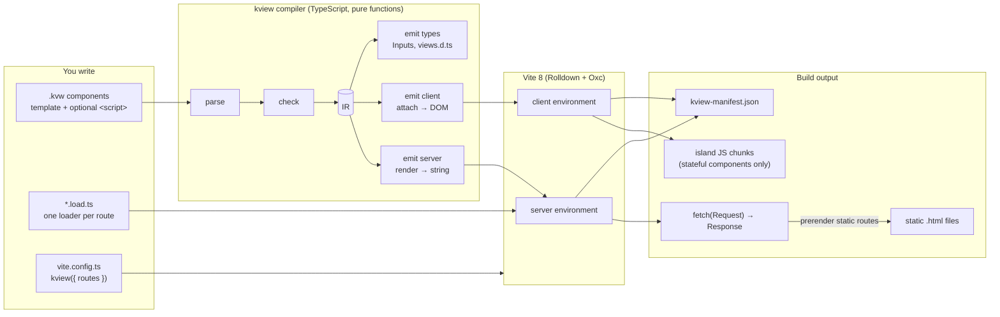
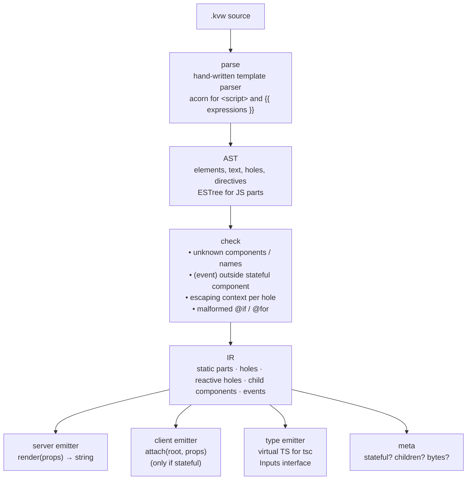
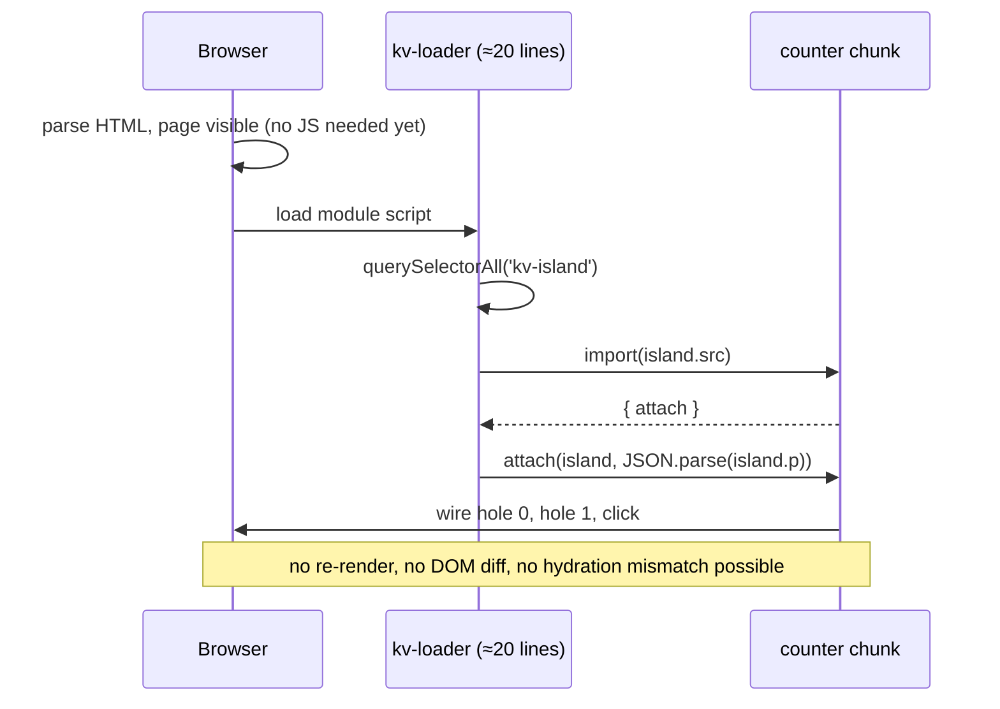
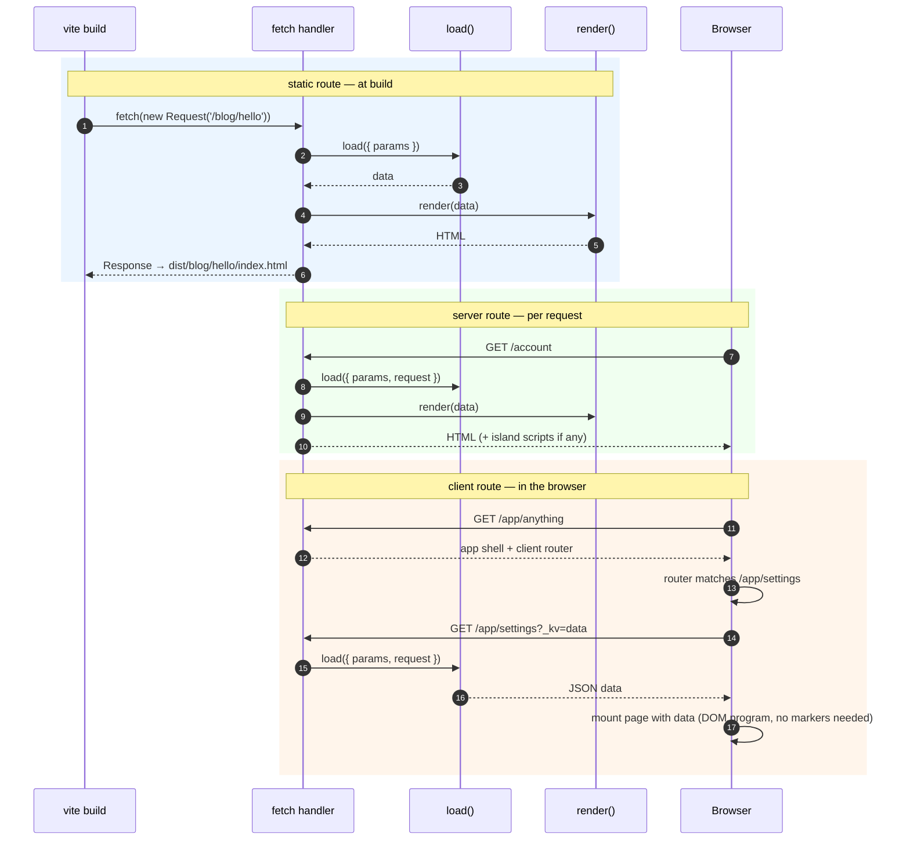
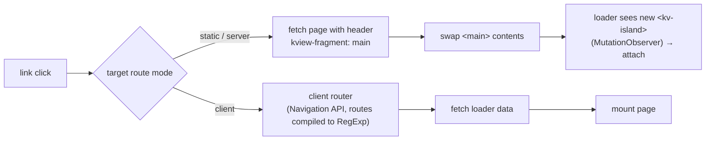
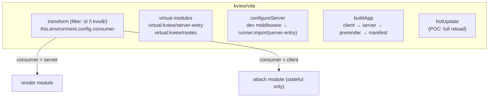
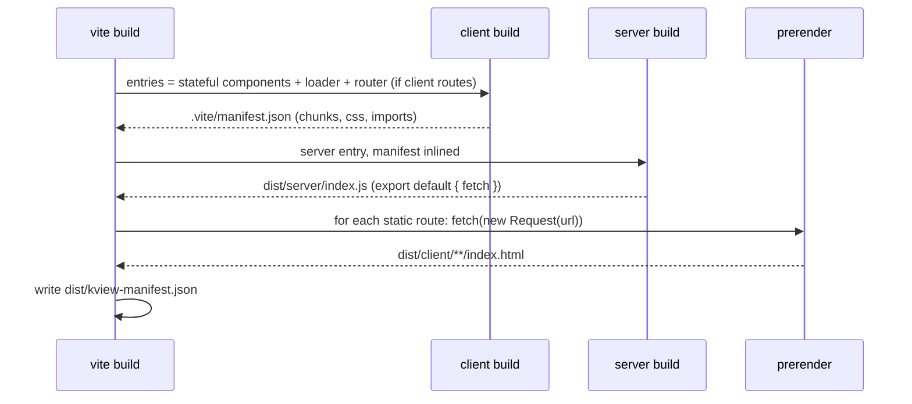
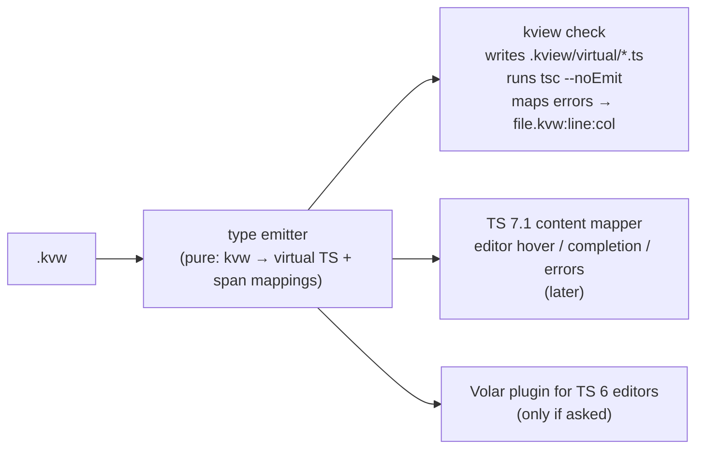

# kview architecture

> How kview turns `.kvw` files into HTML and JS, where every piece runs, and
> how it plugs into Vite, servers, TypeScript and AI agents.
>
> Status: draft for the first proof of concept (POC). Background research
> lives in `.scratch/` (not committed). Items marked **(later)** are designed
> for, not built in the POC.

---

## 1. One sentence

**A `.kvw` file is compiled into a server function that writes HTML, and, only
if it has state, a client function that attaches to that HTML. A route table
says when the server function runs: at build, per request, or in the
browser.**

Everything below expands that sentence.

## 2. Big picture



Three rules make the whole system explainable:

1. **Server code is never in the client module graph.** The client compile
   of a `.kvw` file contains no `render`, no loader, no template strings. This
   is by construction, not by tree shaking.
2. **Only stateful components produce client code.** A component without a
   `<script>` has no client module at all. Zero bytes, always.
3. **One handler produces all HTML.** SSR calls it per request. SSG calls the
   same handler at build time and saves the result. They cannot drift apart.

## 3. Where does my code run?

This table is the heart of kview. `kview explain` prints it for a real route.

| You wrote | `static` route | `server` route | `client` route |
|---|---|---|---|
| Template markup (`<h1>{{ user.name }}</h1>`) | build | each request | browser |
| `*.load.ts` loader | build (once) | each request | server, called by the browser over HTTP |
| `<script>` of a stateful component | build/server (initial values) **and** browser (attach) | server **and** browser | browser |
| `(click)` handlers, `state`, `derived` | browser | browser | browser |
| `@input` types, template checks | compile time only | compile time only | compile time only |

Nothing else runs anywhere. No hidden prefetch, no hidden cache.

## 4. The compiler

Written in TypeScript. A pure `compile(source, options) → { code, map, meta }`
function, called by the Vite plugin and the `kview check` CLI. No file system
access inside the compiler.



### 4.1 Why TypeScript, not Rust or Go

- Vite 8 already does parsing, bundling and minifying in Rust. Compiling
  templates is rarely the slow part. Astro's Go-to-Rust rewrite gained about
  6% on build time.
- Svelte, Vue (including Vapor), Solid, Marko and Angular all compile in JS/TS.
- Passing ASTs between JS and native code is the expensive part, and strings
  are cheap. So the compiler takes a string and returns a string. A Rust port
  (on Oxc) can replace it later without touching anything else **(later, only
  if profiling says so)**.
- Internal JS types are ESTree only, so `oxc-parser` can replace `acorn` with
  no other change.

### 4.2 The IR

The IR is plain data, so it can be dumped for debugging (`kview explain --ir`).

```ts
// shape (simplified)
type ComponentIR = {
  name: string                 // 'counter'
  inputs: Input[]              // from @input
  script?: ScriptIR            // present ⇒ stateful
  nodes: Node[]                // static and dynamic parts, in order
}
type Node =
  | { kind: 'static', html: string }
  | { kind: 'hole', expr: string, context: 'text' | 'attr' | 'url', reactive: boolean, index: number }
  | { kind: 'event', name: 'click', handler: string, index: number }
  | { kind: 'component', name: string, props: Record<string, string>, stateful: boolean }
```

A hole is **reactive** only when its expression reads a `state` or `derived`
of the component's own script. Everything else is rendered once and never
touched again.

### 4.3 What the output looks like

Source:

```kick
{{-- components/counter.kvw --}}
@input start: number = 0

<script>
  let count = state(start)
  const double = derived(() => count * 2)
  function add() { count++ }
</script>

<button (click)="add()">Clicked {{ count }} times (double: {{ double }})</button>
```

Server output (readable, roughly what you'll see in `dist/`):

```js
import { escape as __kv_escape, island as __kv_island } from 'kview/runtime/server'

export function render(__kv_props = {}) {
  const { start = 0 } = __kv_props
  let count = (start)
  const double = (() => count * 2)()
  function add() { count++ }
  return __kv_island("counter", "/src/components/counter.kvw?import", { start }, "<button data-kv-e=\"0\">Clicked " + "<!--[0-->" + __kv_escape(count) + "<!--]-->" + " times (double: " + "<!--[1-->" + __kv_escape(double) + "<!--]-->" + ")</button>")
}
```

Client output:

```js
import { state, derived, holes as __kv_holes, text as __kv_text, on as __kv_on } from 'kview/runtime'

export function attach(__kv_root, __kv_props = {}) {
  const { start = 0 } = __kv_props
  const count = state(start)
  const double = derived(() => count.get() * 2)
  function add() { count.set(count.get() + 1) }

  const __kv_h = __kv_holes(__kv_root)                   // finds <!--[n--> markers, once
  __kv_text(__kv_h[0], () => count.get())               // updates only that text node
  __kv_text(__kv_h[1], () => double.get())
  __kv_on(__kv_root, 0, "click", ($event) => { add() }) // delegated, matched by data-kv-e="0"
}
```

`count++` became `count.set(count.get() + 1)`. That rewrite is the only
"magic", and it's visible in the output. Names kview generates start with
`__kv_`, so they never collide with names in your `<script>`.

## 5. The HTML contract

What the server writes, and what the client reads. This is the hardest thing
to change later, so it's fixed now.

```html
<h1>Ada Lovelace</h1>                         <!-- static: no markers, no JS -->

<kv-island c="counter" src="/assets/counter-3f2a.js" p='{"start":3}'>
  <button data-kv-e="0">
    Clicked <!--[0-->3<!--]--> times (double: <!--[1-->6<!--]-->)
  </button>
</kv-island>

<script type="module" src="/assets/kv-loader-9c1e.js"></script>  <!-- only if page has islands -->
```

| Marker | Meaning |
|---|---|
| `<kv-island c src p>` | stateful component boundary: name, its JS chunk, its serialized props. `display: contents`, so it doesn't affect layout |
| `<!--[n-->…<!--]-->` | reactive hole `n`; the client replaces what's between |
| `data-kv-e="n"` | element with event binding `n` |

Static parts of the page carry **no markers at all**. Islands are
self-describing, so the loader needs no manifest at runtime and can attach to
islands that arrive later (fragment navigation).

Props are serialized with an XSS-safe serializer. Functions and class
instances as island props are a **compile error**.

## 6. The runtime

Target under 5 KB total; the POC aims at about 1–2 KB.

| Module | Job | Runs |
|---|---|---|
| `kview/runtime/server` | `escape`, `escapeAttr`, `island()` | server/build |
| `kview/runtime` signals | `state`, `derived`, `effect` (push-pull, alien-signals-style) | browser |
| `kview/runtime` DOM | `holes`, `text`, `attr`, `on` (one delegated listener per event type) | browser |
| `kview/runtime/loader` | find `<kv-island>`, `import(src)`, call `attach` | browser |



**POC limitation, stated honestly:** `attach` runs the component's `<script>`
again in the browser to recreate its functions, but never re-renders DOM.
**(later)** Serialize the state values into `p` too, so attach uses the
server's values and the script only runs for its functions.

## 7. Data flow

### 7.1 Routes and modes

```ts
// vite.config.ts
import { defineConfig } from 'vite'
import kview from 'kview/vite'

export default defineConfig({
  plugins: [kview({
    routes: {
      '/blog/*':    'static',   // HTML at build time
      '/account/*': 'server',   // HTML per request
      '/app/*':     'client',   // HTML in the browser
    },
  })],
})
```

Pages are files: `src/pages/users/[id].kvw`. The route's loader, if any, is
the sibling `src/pages/users/[id].load.ts`. A separate file makes "this runs
outside the template" visible from the file tree.

```ts
// src/pages/users/[id].load.ts
import type { Load } from 'kview'
export const load: Load<'users/[id]'> = async ({ params, request }) => {
  return { user: await db.users.find(params.id) }   // must match the page's @input
}
```

The return type is checked against the page's `@input` block. Mismatch =
build error.

### 7.2 One loader, three timings



The page component never knows which of the three happened. It only sees
its typed `@input`s.

**Mode guard:** a loader always runs on a server or at build, even for
`client` routes (the browser calls it over HTTP). So secrets in loaders are
safe in every mode, and kview never needs a "server-only" annotation.

## 8. State

| Kind | How | Lives |
|---|---|---|
| Component state | `state()`, `derived()` in `<script>` | one island instance |
| Shared client state | a `.ts` module exporting `state()` values, imported by islands | the browser tab |
| Request data | loader return → `@input` | one request (server) |
| Server-to-client hand-off | island props, serialized into `p` | the HTML |

Shared state is plain module state, no store library:

```ts
// src/stores/cart.ts
import { state } from 'kview'
export const cart = state<Item[]>([])
```

Rule enforced by the compiler: **module state can't be read while rendering
on the server**, because it would leak between requests. Islands may read it
only in the browser. Server-side per-request values flow only through loaders
and props.

## 9. Navigation and routing



- `static` and `server` routes: no client router. The server returns just the
  fragment when it sees the `kview-fragment` header (`Vary` set). Static
  routes get a prebuilt `index.frag.html` beside `index.html` **(later)**.
- Islands re-attach on their own after a swap. You never write an `onLoad`
  hook. Mark an element `kv-persist` to keep it across swaps **(later)**.
- `client` routes: a few-hundred-byte router ships only for them.

## 10. Vite integration

One plugin. It's a thin adapter around the compiler.



| Hook | What kview does |
|---|---|
| `transform` | Compile `.kvw`. Server environment gets `render`, client environment gets `attach`. Hook filter means Rolldown never calls into JS for other files |
| `resolveId`/`load` | Virtual modules: the server entry (route table + handler) and the route list |
| `configureServer` | Dev: turn the Node request into a `Request`, call the handler loaded via `runner.import()`, so server code gets HMR |
| `buildApp` | Build client (with `build.manifest`), build server, call the handler for every `static` route, write `kview-manifest.json` |
| `hotUpdate` | POC: full reload. **(later)** swap the island in place |

Targets Vite 8 (Rolldown). Minimum Vite 6.3 (hook filters). Files are
emitted with `this.emitFile`, never by mutating the bundle.

### 10.1 Build sequence



### 10.2 Route manifest

Plain JSON, one entry per route. This is what `kview explain` reads.

```json
{
  "/users/[id]": {
    "mode": "server",
    "loader": { "file": "src/pages/users/[id].load.ts", "runs": "per request" },
    "islands": [{ "name": "counter", "chunk": "assets/counter-3f2a.js", "bytes": 612 }],
    "js": { "total": 1840, "files": ["assets/kv-loader-9c1e.js", "assets/counter-3f2a.js"] },
    "css": ["assets/users-1b2c.css"]
  }
}
```

## 11. Server integration

The server build exports one standard handler:

```ts
// dist/server/index.js
export default { fetch(request: Request): Promise<Response> }
```

That shape runs unchanged on Bun, Deno and Cloudflare Workers, and on Node
through a tiny adapter (`srvx`, Hono, or ~20 lines). Any existing backend can
mount it:

```ts
// Node, no framework
import { serve } from 'srvx'
import app from './dist/server/index.js'
serve({ fetch: app.fetch, port: 3000 })
```

```ts
// inside an existing Hono / Express-like app: mount on a path
app.all('/app/*', (c) => kv.fetch(c.req.raw))
```

Static-only sites need no server at all: deploy `dist/client/`.

## 12. TypeScript support

One code generator, three hosts.



Template → virtual TS, Angular-style:

| Template | Virtual TS |
|---|---|
| `@input user: User` | `export interface Inputs { user: User }` |
| `{{ user.name }}` | `'' + (user.name);` |
| `@if (user.admin) { … }` | `if (user.admin) { … }` (narrowing works) |
| `@for (u of users) { … }` | `for (const u of users) { … }` |
| `<badge [label]="x" />` | `__kv_component(Badge, { label: x });` |
| `(click)="add()"` | `($event: MouseEvent) => { add() };` |
| `let count = state(0)` | `let count = state(0)` with `state<T>(v: T): T` |

Typed `render('users/show', data)` and `Load<'users/[id]'>` come from a
generated `.kview/views.d.ts` that adds each view to a `ViewRegistry`
interface. Errors TypeScript can't see (unknown component, `(click)` in a
stateless component) come from the compiler, in the same `file:line:col`
format.

## 13. AI agents and humans reading the same things

kview is explainable by producing artifacts, not by special AI features:

| Artifact | Who reads it |
|---|---|
| Readable compiled output in `dist/` | anyone debugging |
| `kview-manifest.json` | tools, CI budgets, agents |
| `kview explain <route> [--json]` | humans (text), agents (JSON) |
| `kview check [--json]` | humans, CI, agents (tsc-style lines) |
| `docs/architecture.md` (this file) | anyone new |
| `llms.txt`, MCP server over `check`/`explain` | agents **(later)** |

Example:

```
$ kview explain /users/42
/users/[id]  mode: server
  loader     src/pages/users/[id].load.ts — runs per request on the server
  render     src/pages/users/[id].kvw     — runs per request on the server
  islands    counter (612 B) — attaches in the browser at load
  static     h1, layout — HTML only, 0 B JS
  total JS   1.8 KB (loader 0.4 KB + counter 0.6 KB + runtime 0.8 KB)
```

## 14. Package layout

One npm package to start, with subpath exports. Split later if needed.

```
kview/
  src/
    compiler/   parse.ts check.ts ir.ts emit-server.ts emit-client.ts emit-types.ts
    runtime/    signals.ts dom.ts loader.ts server.ts
    vite/       plugin.ts dev.ts build.ts
    cli/        check.ts explain.ts
  examples/
    counter/    the POC app
  test/
```

| Export | Contents |
|---|---|
| `kview/compiler` | `compile()` |
| `kview/runtime` | signals + DOM attach (browser) |
| `kview/runtime/server` | escape, island |
| `kview/vite` | the plugin |
| `kview` | types (`Load`, `ViewRegistry`) and `state` for shared stores |

Runtime dependencies: `acorn` (compiler only). Nothing ships to the browser
except kview's own runtime.

## 15. Decisions so far

| Decision | Choice | Alternatives considered |
|---|---|---|
| Compiler language | TypeScript, string in / string out, ESTree types | Rust on Oxc (later, only if profiled); Go (no TS 7 API, Astro left it) |
| Compile strategy | Two emitters (server string, client attach) from one IR | Ship IR as JSON + shared interpreter: bigger runtime, compiler does less |
| JS parser | `acorn` | `oxc-parser`: slower than acorn without experimental raw transfer; Vite's `this.parse` ties compiler to Vite |
| Hydration | Attach to markers, never re-render | Full hydration (mismatch bugs), resumability (Qwik's `$` mental model) |
| Mode selection | Explicit glob table | Inferred from code (Next.js): can't be read or explained |
| Navigation | Server fragments + auto re-attach; client router only for `client` routes | Global SPA router |
| Type checking | Virtual TS + `tsc` via CLI first | Full language server first |

## 16. POC scope

Proves: one page rendered on the server, static `<h1>`, one `<counter>`
interactive in the browser, the counter's chunk + loader as the only JS.

In: parser (elements, text, `{{ }}`, `@input`, `<script>`, `(click)`,
`[prop]`), signal rewrite (`state`, `derived`, `++`, `=`, `+=`), both
emitters, runtime, Vite plugin (dev SSR via `runner.import`), fetch handler,
one test asserting the page's scripts are exactly loader + counter.

Out (designed for, later): `@if`/`@for`, slots, layouts, `kview check`,
modes/loaders/SSG, manifest, `explain`, fragments, router, HMR beyond full
reload, content mapper, MCP.

## 17. Later stages

1. `@if`/`@for` with block markers, nested islands, state serialization, `kview check` + `views.d.ts`.
2. Route modes, loaders with type contracts, `buildApp` prerender, `kview-manifest.json`, `kview explain`.
3. Fragment navigation, auto re-attach, `kv-persist`, client router, lazy attach with event replay.
4. TS 7.1 content mapper (editor support), `llms.txt`, MCP server.
5. Only if profiling demands: `oxc-parser` or a Rust compiler core.

## 18. Open questions

1. Lazy attach triggers (`idle`, `visible`, `interaction`): opt-in attribute on
   the component tag, or a default? (Stage 3.)
2. Do client-mode pages reuse the server-emitted render path for the shell,
   or always mount fresh? (Stage 2–3.)
3. Layout syntax: `@layout('…')` from `.kick`, or nested layout files per
   directory? (Stage 2.)
